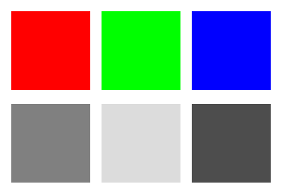
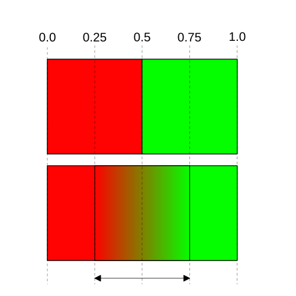

Title: WebGPU Post Processing - 1D Lookup Tables (1D-LUT)
Description: 1D Lookup Tables (LUT)
TOC: 1D Lookup Table (LUT)

This is article is the 2nd in a short series
about image adjustments. Each one builds on the previous lesson so you may find
them easiest to understand by reading them in order.

{{{toc-steps list="image-adjustments.hanson"}}}

Continuing where we left off, let's implement a "duotone" image adjustment.
This is where we use the brightness of an image to select between 2 colors.

<div class="webgpu_center center"><div data-diagram="duotone" data-labels='{"type": "duotone"}'></div></div>

In the image above, dark in the image selects the first color, and brightness
the 2nd. The darker, the closer to the first color, the brighter, the closer
to the 2nd.

We could just chose the max color channel as our brightness and we'd get
an effect but, human eyes are more sensitive to green so,
at least on a computer monitor or phone display, green is brighter than red which
is brighter than blue.

The formula to convert RGB to a brightness, or "luminance" is

```
luminance = red * 0.2126 + green * 0.7152 + blue * 0.07222
```

Looking at that formula, green is ~2.5x brighter than red and ~10x brighter
than blue

<div class="webgpu_center center">
  
  <div>red, green, blue and their equivalent luminance</div>
</div>

Converting that to wgsl we can write it like this

```wgsl
fn luminance(color: vec3f) -> f32 {
  return dot(color, vec3f(0.2126, 0.7152, 0.0722));
}
```

where `dot` multiplies each corresponding elements of the 2 vectors
and adds the results.

Using that we can make a duotone adjustment and add it to our shader
(continuing from the previous article), like this.

```wgsl
fn luminance(color: vec3f) -> f32 {
  return dot(color, vec3f(0.2126, 0.7152, 0.0722));
}

+fn applyDuotone(color: vec3f, color1: vec3f, color2: vec3f) -> vec3f {
+  let l = luminance(color);
+  return mix(color1, color2, l);
+}

...

struct Uniforms {
  brightness: f32,
  contrast: f32,
  @align(16) hsl: HSL,
+  @align(16) duotone: f32,
+  @align(16) duotoneColor1: vec3f,
+  @align(16) duotoneColor2: vec3f,
};

@group(0) @binding(0) var postTexture2d: texture_2d<f32>;
@group(0) @binding(1) var postSampler: sampler;
@group(0) @binding(2) var<uniform> uni: Uniforms;

@fragment fn fs2d(fsInput: VSOutput) -> @location(0) vec4f {
  let color = textureSample(postTexture2d, postSampler, fsInput.texcoord);
  var rgb = color.rgb;
  rgb = adjustHSL(rgb, uni.hsl);
  rgb = adjustBrightness(rgb, uni.brightness);
  rgb = adjustContrast(rgb, uni.contrast);
+  rgb = mix(rgb, applyDuotone(rgb, uni.duotoneColor1, uni.duotoneColor2), uni.duotone);
  return vec4f(rgb, color.a);
}
```

We added a mix amount called `duotone` just so we can decide how
much to use this duotone mix.

Let's remove the HSL settings as they clutter the example

```wgsl
struct Uniforms {
  brightness: f32,
  contrast: f32,
-  @align(16) hsl: HSL,
  @align(16) duotone: f32,
  @align(16) duotoneColor1: vec3f,
  @align(16) duotoneColor2: vec3f,
};

@group(0) @binding(0) var postTexture2d: texture_2d<f32>;
@group(0) @binding(1) var postSampler: sampler;
@group(0) @binding(2) var<uniform> uni: Uniforms;

@fragment fn fs2d(fsInput: VSOutput) -> @location(0) vec4f {
  let color = textureSample(postTexture2d, postSampler, fsInput.texcoord);
  var rgb = color.rgb;
-  rgb = adjustHSL(rgb, uni.hsl);
  rgb = adjustBrightness(rgb, uni.brightness);
  rgb = adjustContrast(rgb, uni.contrast);
  rgb = mix(rgb, applyDuotone(rgb, uni.duotoneColor1, uni.duotoneColor2), uni.duotone);
  return vec4f(rgb, color.a);
}
```

And we need to update our JavaScript to set the duotone parameters.

```js
  function postProcess(encoder, srcTexture, dstTexture) {
    device.queue.writeBuffer(
      postProcessUniformBuffer,
      0,
      new Float32Array([
        settings.brightness,
        settings.contrast,
        0,
        0,
-        settings.hue,
-        settings.saturation,
-        settings.lightness,
-        0,
+        settings.duotone,
+        0,
+        0,
+        0,
+        ...settings.duotoneColor1, 0,
+        ...settings.duotoneColor2, 0,
      ]),
    );

    postProcessRenderPassDescriptor.colorAttachments[0].view = dstTexture;
    const pass = encoder.beginRenderPass(postProcessRenderPassDescriptor);
    pass.setPipeline(postProcessPipeline);
    pass.setBindGroup(0, postProcessBindGroup);
    pass.draw(3);
    pass.end();
  }

  const settings = {
    brightness: 0,
    contrast: 0,
-    hue: 0,
-    saturation: 0,
-    lightness: 0,
+    duotone: 1,
+    duotoneColor1: new Float32Array([0.1, 0, 0.5]),
+    duotoneColor2: new Float32Array([1, 0.69, 0.4]),
  };

  const gui = new GUI();
  gui.onChange(render);
  gui.add(settings, 'brightness', -1, 1);
  gui.add(settings, 'contrast', -1, 10);
-  gui.add(settings, 'hue', -0.5, 0.5);
-  gui.add(settings, 'saturation', -1, 1);
-  gui.add(settings, 'lightness', -1, 1);
+  gui.add(settings, 'duotone', 0, 1);
+  gui.addColor(settings, 'duotoneColor1');
+  gui.addColor(settings, 'duotoneColor2');
```

And with that we get a duotone affect.

{{{example url="../webgpu-post-processing-image-adjustments-duotone.html"}}}

Note that many common effects can be done this way. For example "sepia"
is basically just a matter of choosing sepia tones

<div class="webgpu_center center"><div data-diagram="sepia" data-labels='{"type": "sepia"}'></div></div>

# <a href="a-texture"></a> Using a texture

In the code above we are `mix`ing between 2 colors.

```js
  let l = luminance(color);
  return mix(color1, color2, l);
```

Another way to mix between colors is to use a 2ˣ1 pixel texture with linear filtering
as we covered in [the article on textures](webgpu-textures.html#a-linear-interpolation).

Let's do that. Here is some WGSL code to use a texture to mix its colors
across the texture.

```wgsl
fn apply1DLUT(
    color: vec3f,
    lut: texture_2d<f32>,
    smp: sampler) -> vec3f {
  let l = luminance(color);
  let width = f32(textureDimensions(lut, 0).x);
  let range = (width - 1) / width;
  let u = 0.5 / width + l * range;
  return textureSample(lut, smp, vec2f(u, 0.5)).rgb;
}
```

What's up with all that extra math. Why is it not just

```wgsl
// Warning: Won't work!
fn apply1DLUT(
    color: vec3f,
    lut: texture_2d<f32>,
    smp: sampler) -> vec3f {
  let l = luminance(color);
  return textureSample(lut, smp, vec2f(l, 0.5)).rgb;
}
```

Recall how linear texture sampling work.

<div class="webgpu_center center">
  
  <div>2x1 pixel texture and the color from each coordinate</div>
</div>

If we look at a 2ˣ1 pixel texture, sampling from 0.0 to the center of the left most
pixel just returns the color of the first pixel. Similarly the center of the
right most to 1.0 we get just the color of the 2nd pixel. We only want the part
between the 2 pixels so we to map the luminance value to the range in coordinate
space between the 2 pixels and then add 0.5 a pixel.

With that, we can use our new function

```wgsl
struct Uniforms {
  brightness: f32,
  contrast: f32,
-  @align(16) duotone: f32,
-  @align(16) duotoneColor1: vec3f,
-  @align(16) duotoneColor2: vec3f,
+  gradient: f32,
};

@group(0) @binding(0) var postTexture2d: texture_2d<f32>;
@group(0) @binding(1) var postSampler: sampler;
@group(0) @binding(2) var<uniform> uni: Uniforms;
+@group(1) @binding(0) var lut: texture_2d<f32>;
+@group(1) @binding(1) var lutSampler: sampler;

@fragment fn fs2d(fsInput: VSOutput) -> @location(0) vec4f {
  let color = textureSample(postTexture2d, postSampler, fsInput.texcoord);
  var rgb = color.rgb;
  rgb = adjustBrightness(rgb, uni.brightness);
  rgb = adjustContrast(rgb, uni.contrast);
-  rgb = mix(rgb, applyDuotone(rgb, uni.duotoneColor1, uni.duotoneColor2), uni.duotone);
+  rgb = mix(rgb, apply1DLUT(rgb, lut, lutSampler), uni.gradient);

  return vec4f(rgb, color.a);
}
```

In the shader we put the gradient texture and sampler in their own group.

We then need to create a texture, a sampler, and a bindGroup

```js
  const lutSampler = device.createSampler({
    magFilter: 'linear',
    minFilter: 'linear',
  });

  const rgbToUnorm8 = (rgb) => [0, 0, 0, 1].map((v, i) => (rgb[i] ?? v) * 255 | 0);
  const gradientColors = new Uint8Array([
    ...rgbToUnorm8([0.1, 0, 0.5]),
    ...rgbToUnorm8([1, 0.69, 0.4]),
  ]);
  const lutTexture = device.createTexture({
    size: [2],
    format: 'rgba8unorm',
    usage: GPUTextureUsage.COPY_DST | GPUTextureUsage.TEXTURE_BINDING,
  });
  device.queue.writeTexture(
    { texture: lutTexture },
    gradientColors,
    { },
    [2],
  );

  const lutBindGroup = device.createBindGroup({
    layout: postProcessPipeline.getBindGroupLayout(1),
    entries: [
      { binding: 0, resource: lutTexture },
      { binding: 1, resource: lutSampler },
    ],
  });
```

Here we're making 2 rgba8unorm values from our previous duotone colors.
and uploading them to a 2ˣ1 texture.

```js
  function postProcess(encoder, srcTexture, dstTexture) {
    device.queue.writeBuffer(
      postProcessUniformBuffer,
      0,
      new Float32Array([
        settings.brightness,
        settings.contrast,
-        0,
-        0,
-        settings.duotone,
-        0,
-        0,
-        0,
-        ...settings.duotoneColor1, 0,
-        ...settings.duotoneColor2, 0,
+        settings.lutAmount,
      ]),
    );

    postProcessRenderPassDescriptor.colorAttachments[0].view = dstTexture;
    const pass = encoder.beginRenderPass(postProcessRenderPassDescriptor);
    pass.setPipeline(postProcessPipeline);
    pass.setBindGroup(0, postProcessBindGroup);
+    pass.setBindGroup(0, lutBindGroup);
    pass.draw(3);
    pass.end();
  }

  const settings = {
    brightness: 0,
    contrast: 0,
-    duotone: 1,
-    duotoneColor1: new Float32Array([0.1, 0, 0.5]),
-    duotoneColor2: new Float32Array([1, 0.69, 0.4]),
+    lutAmount: 1,
  };

  const gui = new GUI();
  gui.onChange(render);
  gui.add(settings, 'brightness', -1, 1);
  gui.add(settings, 'contrast', -1, 10);
-  gui.add(settings, 'duotone', 0, 1);
-  gui.addColor(settings, 'duotoneColor1');
-  gui.addColor(settings, 'duotoneColor2');
+  gui.add(settings, 'lutAmount', 0, 1);
```

And with that we've switched to using a texture.

{{{example url="../webgpu-post-processing-image-adjustments-1d-lut.html"}}}

With all that effort, the results look exactly the same as the previous
example so what was the point? Further, in order to change the colors we'd
have to update the texture with new colors.

The point is, you can now supply any number of colors. Just make larger textures.
You do not have to update the shader.

Here are 12 examples, below each image is the 256x1 texture being passed
into the same code above. This is often called a [gradient map](https://google.com/search?q=gradient%20map) as it maps the luminance of the image through
a "gradient". The texture does not have to be gradients though. You can see a
couple of examples where the texture has solid colors, not gradients.

<div class="webgpu_center center"><div data-diagram="luts" class="fill-container" style="max-width: 1200px"></div></div>

Let's make some code to make these gradient textures. Given a set of colors
and stops between 0 an 1, we could write code to interpolate between them and create the textures. But,
the browser already has gradient making code in its 2d library so let's use
that.

Here's some gradient data where each entry is r, g, b in unorm8 format (0-255)
and the last number is a value 0.0 to 1.0 where on the gradient that color is

```js
  const gradients = [
    [
      [  0,   0,   0, 0.0],
      [236,  23, 223, 0.37],
      [255, 144,   0, 0.48],
      [255, 255, 255, 1],
    ],
    [
      [  0,   0,   0, 0.0],
      [236,  23,  23, 0.33],
      [230, 194, 108, 0.50],
      [249, 197, 241, 0.64],
      [255, 255, 255, 1],
    ],
    [
      [ 10,  10,  10, 0.0],
      [ 90,   0, 255, 0.40],
      [255,   0,   0, 0.70],
      [132, 255,   0, 1],
    ],
    [
      [ 20,  20,  20, 0.0],
      [  0,  61, 201, 0.24],
      [ 76, 229, 155, 0.47],
      [246, 239,  45, 0.66],
      [255, 255, 255, 0.80],
    ],
    [
      [  4,   4,   4, 0.0],
      [  0, 184, 255, 0.50],
      [255, 133,   0, 0.60],
      [255, 255, 255, 1],
    ],
    [
      [ 17,  37,  81, 0.0],
      [198, 229, 112, 0.43],
      [255, 215, 104, 0.51],
      [252, 235, 241, 0.59],
      [ 97, 159, 234, 0.85],
      [  0,  65, 128, 1],
    ],
    [
      [  0,   0,   0, 0.0],
      [ 10,   0, 178, 0.14],
      [255,   0,   0, 0.50],
      [ 50, 178,   0, 0.61],
      [255, 252,   0, 0.80],
      [255, 255, 255, 0.98],
    ],
    [
      [  0,   0,   0, 0.0],
      [204,  27, 236, 0.25],
      [ 54, 129, 221, 0.41],
      [ 71, 193, 223, 0.60],
      [231, 203,  47, 0.79],
      [255, 255, 255, 1],
    ],
    [
      [ 27,  27,  27, 0.4],
      [114,   0, 255, 0.15],
      [  0, 228, 255, 0.61],
      [236, 196, 196, 0.68],
      [255, 211, 211, 1],
    ],
    [
      [ 26,  47,  71, 0.44],
      [207,  27,  38, 0.44],
      [207,  27,  38, 0.64],
      [103, 138, 146, 0.64],
      [103, 138, 146, 0.75],
      [231, 210, 155, 0.75],
    ],
    [
      [  0,   0,   0, 0.0],
      [ 51, 186, 236, 0.42],
      [248, 179,  13, 0.74],
      [255, 255, 255, 1],
    ],
    [
      [  0,   0,   0, 0.27],
      [ 54, 167, 227, 0.27],
      [ 54, 167, 227, 0.38],
      [154, 148, 194, 0.38],
      [154, 148, 194, 0.49],
      [166, 204,  59, 0.49],
      [166, 204,  59, 0.60],
      [227, 141,  32, 0.60],
      [227, 141,  32, 0.73],
      [246, 231,   8, 0.73],
      [246, 231,   8, 0.82],
      [255, 255, 255, 0.82],
    ],
    [
      [  0,   0,   0, 0],
      [255, 255, 255, 1],
    ],
    [
      [  0,   0,   0, 0.25],
      [255, 255, 255, 0.75],
    ],
    [
      [112,  66,  20, 0],
      [250, 235, 215, 1],
    ],
  ];
```

We can make gradient textures from those using a 2d
[linear gradient](https://developer.mozilla.org/en-US/docs/Web/API/CanvasRenderingContext2D/createLinearGradient).

```js
  const lutSampler = device.createSampler({
    magFilter: 'linear',
    minFilter: 'linear',
  });

-  const rgbToUnorm8 = (rgb) => [0, 0, 0, 1].map((v, i) => (rgb[i] ?? v) * 255 | 0);
-  const gradientColors = new Uint8Array([
-    ...rgbToUnorm8([0.1, 0, 0.5]),
-    ...rgbToUnorm8([1, 0.69, 0.4]),
-  ]);
-  const lutTexture = device.createTexture({
-    size: [2],
-    format: 'rgba8unorm',
-    usage: GPUTextureUsage.COPY_DST | GPUTextureUsage.TEXTURE_BINDING,
-  });
-  device.queue.writeTexture(
-    { texture: lutTexture },
-    gradientColors,
-    { },
-    [2],
-  );
+  const ctx = new OffscreenCanvas(256, 1).getContext('2d');
+  const lutBindGroups = gradients.map(stops => {
+    const grad = ctx.createLinearGradient(0, 0, ctx.canvas.width, 0);
+    for (const [r, g, b, stop] of stops) {
+      grad.addColorStop(stop, `rgb(${r}, ${g}, ${b})`);
+    }
+    ctx.fillStyle = grad;
+    ctx.fillRect(0, 0, ctx.canvas.width, 1);
+    const texture = createTextureFromSource(device, ctx.canvas);
+
+    return device.createBindGroup({
+      layout: postProcessPipeline.getBindGroupLayout(1),
+      entries: [
+        { binding: 0, resource: texture },
+        { binding: 1, resource: lutSampler },
+      ],
+    });
+  });
```

We made a bindGroup for each gradient. Now need to use them

```js
  function postProcess(encoder, srcTexture, dstTexture) {
    ...

    postProcessRenderPassDescriptor.colorAttachments[0].view = dstTexture;
    const pass = encoder.beginRenderPass(postProcessRenderPassDescriptor);
    pass.setPipeline(postProcessPipeline);
    pass.setBindGroup(0, postProcessBindGroup);
-    pass.setBindGroup(1, lutBindGroup);
+    pass.setBindGroup(1, lutBindGroups[settings.lut]);
    pass.draw(3);
    pass.end();
  }

  const settings = {
    brightness: 0,
    contrast: 0,
    lutAmount: 1,
+    lut: 0,
  };

  const gui = new GUI();
  gui.onChange(render);
  gui.add(settings, 'brightness', -1, 1);
  gui.add(settings, 'contrast', -1, 10);
  gui.add(settings, 'lutAmount', 0, 1);
```

And we need a way to select a gradient. Let's use CSS to display the
gradients so we can click on them.

First a container element.

```html
  <body>
    <canvas></canvas>
+    <div id="ui"></div>
  </body>
```

and some CSS

```css
#ui {
  position: absolute;
  left: 0px;
  top: 0px;
  overflow: auto;
  height: 100%;
}
.gradient {
  margin: 1px;
  width: 100px;
  height: 20px;
}
```

And then lets created elements with gradients using CSS
[linear-gradient](https://developer.mozilla.org/en-US/docs/Web/CSS/Reference/Values/gradient/linear-gradient).

```js
  const uiElem = document.querySelector('#ui');
  gradients.forEach((stops, i) => {
    const div = document.createElement('div');
    div.className = 'gradient';
    div.style.background = `linear-gradient(to right,
      ${stops.map(([r, g, b, stop]) => `rgb(${r}, ${g}, ${b}) ${stop * 100}%`).join(',')}
    )`;
    div.addEventListener('click', () => {
      settings.lut = i;
      render();
    });
    uiElem.append(div);
  });
```

And, the result:

{{{example url="../webgpu-post-processing-image-adjustments-1d-luts.html"}}}

In the [next article](webgpu-3dlut.html) we'll expand these linear
textures to 3D textures.

<!-- keep this at the bottom of the article -->
<link href="webgpu-1dlut.css" rel="stylesheet">
<script type="module" src="webgpu-1dlut.js"></script>
