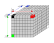
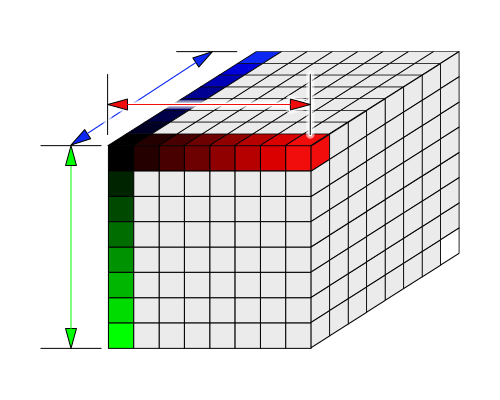
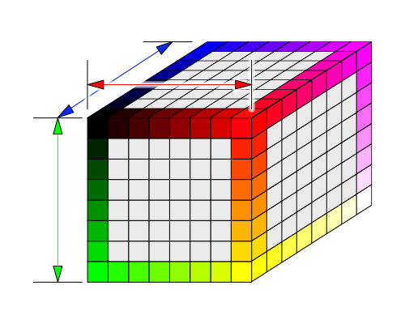
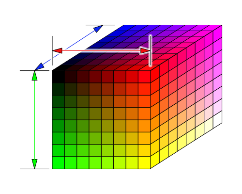
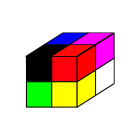
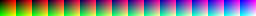
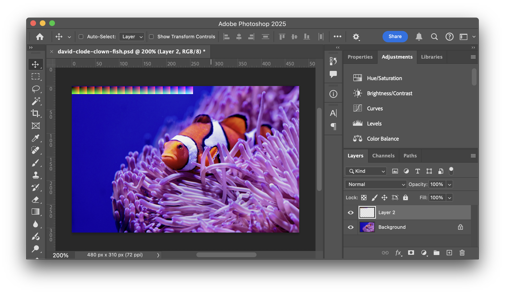
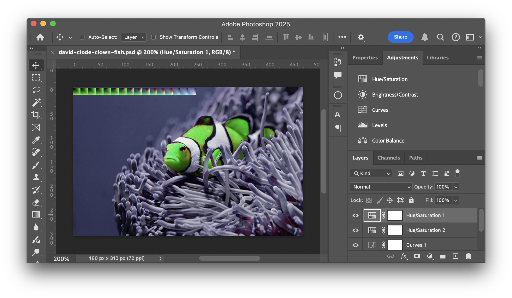

Title: WebGPU Post Processing - 3d lookup table (LUT)
Description: 3D lookup table (LUT)
TOC: 3D Lookup Table (LUT)

This is article is the 3nd in a short series
about image adjustments. Each one builds on the previous lesson so you may find
them easiest to understand by reading them in order.

{{{toc-steps list="image-adjustments.hanson"}}}


In the last article we went over [gradient maps](webgpu-1dlut.html), which we could
also call a 1d lookup table or 1D-LUT for short. Our 1D-LUTs were n pixels wide and 1
tall. A 3D-LUT is the same idea but in 3D.

How it works is we make a cube of colors. Then we index the cube using the colors of our source image. For each pixel in the original image we look up a position in the cube based on the red, green, and blue colors of the original pixel. The value we pull out of the 3D-LUT is the new color.

In Javascript we might do it like this. Imagine the colors are specified in integers from 0 to 255 and we have a large 3 dimensional array 256x256x256 in size. Then to translate a color through the look up table we'd do this

```js
    const newColor = lut[origColor.red][origColor.green][origColor.bue];
```

Of course a 256x256x256 array would be rather large but as we pointed out in [the article on textures](webgpu-textures.html), textures are referenced from values of 0.0 to 1.0 regardless of the dimensions of the texture.

Let's imagine an 8x8x8 cube.

<div class="webgpu_center"></div>

First we might fill in the corners with 0,0,0 corner being pure black, the opposite 1,1,1 corner pure white. 1,0,0 being pure <span style="color:red;">red</span>. 0,1,0 being pure <span style="color:green;">green</span> and 0,0,1 being <span style="color:blue;">blue</span>. 

<div class="webgpu_center"></div>

We'd add in the colors down each axis.

<div class="webgpu_center"></div>

And the colors on edges that use 2 or more channels.

<div class="webgpu_center"></div>

And finally fill in all the colors in between. This is an "identity" 3D-LUT. It produces the exact same output as input. If you look up a color you'll get the same color out.

<div class="webgpu_center"><object type="image/svg+xml" data="resources/images/3dlut-standard-lookup.svg" class="noinvertdark" data-diagram="lookup" style="width: 600px"></object></div>

If we change the cube to shades of amber though then as we look up colors, we look up the same locations in the 3D lookup table but they produce different output.

<div class="webgpu_center"><object type="image/svg+xml" data="resources/images/3dlut-amber-lookup.svg" class="noinvertdark" data-diagram="lookup" style="width: 600px"></object></div>

Using this technique, by supplying a different lookup table we can apply all kinds of effects. Basically any effect that can be computed based only on a single color input. Those effects include all the ones we made in the previous articles. Adjusting hue, contrast, saturation, color cast, tint, brightness, exposure, levels, curves, posterization, shadows, highlights, and many others. Even better they can all be combined into a single look up table.

Here's the WGSL we need. It's very similar to the `apply1DLUT` function

```wgsl
fn apply1DLUT(
    color: vec3f,
    lut: texture_2d<f32>,
    smp: sampler) -> vec3f {
  let l = luminance(color);
  let width = f32(textureDimensions(lut, 0).x);
  let range = (width - 1) / width;
  let u = 0.5 / width + l * range;
  return textureSample(lut, smp, vec2f(u, 0.5)).rgb;
}

+fn apply3DLUT(
+    color: vec3f,
+    lut: texture_3d<f32>,
+    smp: sampler) -> vec3f {
+  let size = vec3f(textureDimensions(lut, 0));
+  let range = (size - 1) / size;
+  let uvw = 0.5 / size + color * range;
+  return textureSample(lut, smp, uvw).rgb;
+}
```

Let's apply it to our shaders. While we're at lets remove the all the other adjustments.

```wgsl
struct Uniforms {
-  brightness: f32,
-  contrast: f32,
  lutAmount: f32,
};

@group(0) @binding(0) var postTexture2d: texture_2d<f32>;
@group(0) @binding(1) var postSampler: sampler;
@group(0) @binding(2) var<uniform> uni: Uniforms;
-@group(1) @binding(0) var lut: texture_2d<f32>;
+@group(1) @binding(0) var lut: texture_3d<f32>;
@group(1) @binding(1) var lutSampler: sampler;

@fragment fn fs2d(fsInput: VSOutput) -> @location(0) vec4f {
  let color = textureSample(postTexture2d, postSampler, fsInput.texcoord);
  var rgb = color.rgb;
-  rgb = adjustBrightness(rgb, uni.brightness);
-  rgb = adjustContrast(rgb, uni.contrast);
-  rgb = mix(rgb, apply1DLUT(rgb, lut, lutSampler), uni.lutAmount);
+  rgb = mix(rgb, apply3DLUT(rgb, lut, lutSampler), uni.lutAmount);
  return vec4f(rgb, color.a);
}
```

To use it we'll need a 3D texture. The simplest 3D-LUT is a 2x2x2 identity LUT where *identity* means nothing happens. It's like multiplying by 1 or doing nothing, even though we're looking up colors in the LUT each color in maps to the same color out.

<div class="webgpu_center"></div>

Here's the code to make a 2ˣ2ˣ2 3D texture with the colors required for an identity LUT.

```js
function makeIdentityLutTexture(device) {
  const texture = device.createTexture({
    size: [2, 2, 2],
    dimension: '3d',
    format: 'rgba8unorm',
    usage: GPUTextureUsage.TEXTURE_BINDING | GPUTextureUsage.COPY_DST,
  });

  const identityLUT = new Uint8Array([
      0,   0,   0, 255,  // black
    255,   0,   0, 255,  // red
      0, 255,   0, 255,  // green
    255, 255,   0, 255,  // yellow
      0,   0, 255, 255,  // blue
    255,   0, 255, 255,  // magenta
      0, 255, 255, 255,  // cyan
    255, 255, 255, 255,  // white
  ]);

  device.queue.writeTexture(
    { texture },
    identityLUT,
    { bytesPerRow: 8, rowsPerImage: 2 },
    [2, 2, 2],
  );

  return texture;
}
```

We need some code to use it. Let's use it twice, once with linear filtering
and once without.

```js
  const lutNearestSampler = device.createSampler();
  const lutLinearSampler = device.createSampler({
    magFilter: 'linear',
    minFilter: 'linear',
  });

  function makeLutBindGroup(texture, sampler) {
    return device.createBindGroup({
      layout: postProcessPipeline.getBindGroupLayout(1),
      entries: [
        { binding: 0, resource: texture },
        { binding: 1, resource: sampler },
      ],
    });
  }

  const identityLutTexture = makeIdentityLutTexture(device);
  const lutBindGroups = [
    {
      name: 'identity',
      bindGroup: makeLutBindGroup(identityLutTexture, lutLinearSampler),
    },
    {
      name: 'identity (nearest)',
      bindGroup: makeLutBindGroup(identityLutTexture, lutNearestSampler),
    },
  ];

  ...

  function postProcess(encoder, srcTexture, dstTexture) {
    device.queue.writeBuffer(
      postProcessUniformBuffer,
      0,
      new Float32Array([
-        settings.brightness,
-        settings.contrast,
        settings.lutAmount,
      ]),
    );

    postProcessRenderPassDescriptor.colorAttachments[0].view = dstTexture;
    const pass = encoder.beginRenderPass(postProcessRenderPassDescriptor);
    pass.setPipeline(postProcessPipeline);
    pass.setBindGroup(0, postProcessBindGroup);
-    pass.setBindGroup(1, lutBindGroups[settings.lut]);
+    pass.setBindGroup(1, lutBindGroups[settings.lut].bindGroup);
    pass.draw(3);
    pass.end();
  }

  const settings = {
-    brightness: 0,
-    contrast: 0,
    lutAmount: 1,
    lut: 0,
  };

  const gui = new GUI();
  gui.onChange(render);
-  gui.add(settings, 'brightness', -1, 1);
-  gui.add(settings, 'contrast', -1, 10);
  gui.add(settings, 'lutAmount', 0, 1);
+  const keyValues = Object.fromEntries(lutBindGroups.map(({name}, i) => [name, i]));
+  gui.add(settings, 'lut', { keyValues });

-  const uiElem = document.querySelector('#ui');
-  gradients.forEach((stops, i) => {
-    const div = document.createElement('div');
-    div.className = 'gradient';
-    div.style.background = `linear-gradient(to right,
-      ${stops.map(([r, g, b, stop]) => `rgb(${r}, ${g}, ${b}) ${stop * 100}%`).join(',')}
-    )`;
-    div.addEventListener('click', () => {
-      settings.lut = i;
-      render();
-    });
-    uiElem.append(div);
-  });
```

With that we get the identity lut which has zero affect 😂 but at least
we can try it without filtering and see a strong effect.

{{{example url="../webgpu-post-processing-image-adjustments-3d-lut.html" }}}

First decide on the resolution of the LUT you want and generate the slices of the lookup cube using a simple script.

```js
const ctx = document.querySelector('canvas').getContext('2d');

function drawColorCubeImage(ctx, size) {
  const canvas = ctx.canvas;
  canvas.width = size * size;
  canvas.height = size;

  for (let zz = 0; zz < size; ++zz) {
    for (let yy = 0; yy < size; ++yy) {
      for (let xx = 0; xx < size; ++xx) {
        const r = Math.floor(xx / (size - 1) * 255);
        const g = Math.floor(yy / (size - 1) * 255);
        const b = Math.floor(zz / (size - 1) * 255);
        ctx.fillStyle = `rgb(${r},${g},${b})`;
        ctx.fillRect(zz * size + xx, yy, 1, 1);
      }
    }
  }
}

drawColorCubeImage(ctx, 8);
```

and we need some html

```html
<h1>Color Cube Image Maker</h1>
<div>size:<input id="size" type="number" value="8" min="2" max="64"/></div>
<p><button type="button">Save...</button></p>
<div id="cube"><canvas></canvas></div>
<div>( note: actual image size is
<span id="width"></span>x<span id="height"></span> )</div>
</p>
```

And to JS to make a UI

```js
function update(size) {
  drawColorCubeImage(ctx, size);
  document.querySelector('#width').textContent = ctx.canvas.width;
  document.querySelector('#height').textContent = ctx.canvas.height;
}
update(8);

function handleSizeChange(event) {
  const elem = event.target;
  elem.style.background = '';
  try {
    const size = parseInt(elem.value);
    if (size >= 2 && size <= 64) {
      update(size);
    }
  } catch (e) {
    elem.style.background = 'red';
  }
}

const sizeElem = document.querySelector('#size');
sizeElem.addEventListener('change', handleSizeChange, true);

const saveData = (function() {
  const a = document.createElement('a');
  document.body.appendChild(a);
  a.style.display = 'none';
  return function saveData(blob, fileName) {
    const url = window.URL.createObjectURL(blob);
    a.href = url;
    a.download = fileName;
    a.click();
  };
}());

document.querySelector('button').addEventListener('click', () => {
  ctx.canvas.toBlob((blob) => {
    saveData(blob, `identity-lut-s${ctx.canvas.height}.png`);
  });
});
```

Now we can generate a identity 3d lookup table for any size. [^size]

[^size]: Adobe .cube files are generally 33ˣ33ˣ33

{{{example url="../3dlut-base-cube-maker.html" }}}

The larger the resolution the more fine adjustments we can make but being a cube of data the size required grows quickly. A size 8 cube only requires 2k but a size 64 cube requires 1meg. So use the smallest that reproduces the effect you want.

Let's set the size to 16 and then click save the file which gives us this file.

<div class="webgpu_center"></div>

We then go it into an image editor, in my case Photoshop, load up a sample image, and paste the 3D-LUT in the top left corner

> note: I first tried dragging and dropping the cube file on top of the image
> in Photoshop but that didn't work. Photoshop made the image twice as large.
> I'm guessing it was trying to match DPI or something. Loading the cube file
> separately and then copying and pasting it into the screen capture worked.

<div class="webgpu_center"></div>

We then use any of the color based full image adjustments to adjust the image. For Photoshop most of the adjustments we can use are available on the Adjustments tab.

<div class="webgpu_center"></div>

After we've adjusted the image to our liking you can see the cube slices we placed in the top left corner have the same adjustments applied.

Okay but how do we use it?

First I saved it as a png `3d-lut-orange-to-green-s16.png`. To save memory we could have cropped it to just the 256ˣ16 top left corner of the LUT table but just for fun we'll crop it after loading. The good thing about using this method is we can get some idea of the effective of the LUT just by looking at the .png file. The bad thing is of course wasted bandwidth.

Here's some code to load it. The code loads the image, copies out only the 3D-LUT part into a canvas, gets the data from the canvas, uploads it to the texture one slice at a time.

```js
/**
 * create a LUT texture from an image URL. You must pass in the size of the LUT
 * It's assumed to be in the top left corner of the image.
 *
 * +---------+---------+---------+---------+---------+---------+---→
 * |         |         |         |         |         |         |
 * | layer 0 | layer 1 | layer 2 | layer 3 |   ...   | layer n |
 * |         |         |         |         |         |         |
 * +---------+---------+---------+---------+---------+---------+
 * |
 * ↓
 */
const createLUTTextureFromImage = (function() {
  const ctx = new OffscreenCanvas(1, 1).getContext('2d', { willReadFrequently: true });

  return async function createLUTTextureFromImage(device, url, lutSize) {
    const img = new Image();
    img.src = url;
    await img.decode();
    ctx.canvas.width = lutSize * lutSize;
    ctx.canvas.height = lutSize;
    ctx.drawImage(img, 0, 0);
    const imgData = ctx.getImageData(0, 0, lutSize * lutSize, lutSize);

    const texture = device.createTexture({
      size: [lutSize, lutSize, lutSize],
      dimension: '3d',
      format: 'rgba8unorm',
      usage: GPUTextureUsage.TEXTURE_BINDING | GPUTextureUsage.COPY_DST,
    });

    for (let z = 0; z < lutSize; ++z) {
      device.queue.writeTexture(
        { texture, origin: [0, 0, z] },
        imgData.data,
        { offset: z * lutSize * 4, bytesPerRow: imgData.width * 4 },
        [lutSize, lutSize],
      );
    }
    return texture;
  };
})();
```

Let's add our custom lut to the list of existing luts.

```js
+  const lutTextures = [
+    { name: 'custom',          url: 'resources/images/lut/3d-lut-orange-to-green-s16.png'},
+  ];
+  lutBindGroups.push(...await Promise.all(lutTextures.map(async({name, url}) => {
+    // assumes filename ends in '-s<num>[n]'
+    // where <num> is the size of the 3DLUT cube
+    // and [n] means 'no filtering' or 'nearest'
+    //
+    // examples:
+    //    'foo-s16.png' = size:16, filter: true
+    //    'bar-s8n.png' = size:8, filter: false
+    const m = /-s(\d+)(n*)\.[^.]+$/.exec(url);
+    const size = parseInt(m[1]);
+    const filter = m[2] === '';
+
+    const texture = await createLUTTextureFromImage(device, url, size);
+    const sampler = filter
+      ? lutLinearSampler
+      : lutNearestSampler;
+    return {name, bindGroup: makeLutBindGroup(texture, sampler)};
+  })));
```

Above you can see we encoded the size of the LUT into the end of the filename. This makes it easier to pass around LUTs as pngs

While we're at it, , lets load a bunch more image based 3D-luts 

```js
  const lutTextures = [
    { name: 'custom',          url: 'resources/images/lut/3d-lut-orange-to-green-s16.png'},
+    { name: 'monochrome',      url: 'resources/images/lut/monochrome-s8.png' },
+    { name: 'sepia',           url: 'resources/images/lut/sepia-s8.png' },
+    { name: 'saturated',       url: 'resources/images/lut/saturated-s8.png', },
+    { name: 'posterize',       url: 'resources/images/lut/posterize-s8n.png', },
+    { name: 'posterize-3-rgb', url: 'resources/images/lut/posterize-3-rgb-s8n.png', },
+    { name: 'posterize-3-lab', url: 'resources/images/lut/posterize-3-lab-s8n.png', },
+    { name: 'posterize-4-lab', url: 'resources/images/lut/posterize-4-lab-s8n.png', },
+    { name: 'posterize-more',  url: 'resources/images/lut/posterize-more-s8n.png', },
+    { name: 'inverse',         url: 'resources/images/lut/inverse-s8.png', },
+    { name: 'color negative',  url: 'resources/images/lut/color-negative-s8.png', },
+    { name: 'funky contrast',  url: 'resources/images/lut/funky-contrast-s8.png', },
+    { name: 'nightvision',     url: 'resources/images/lut/nightvision-s8.png', },
+    { name: 'thermal',         url: 'resources/images/lut/thermal-s8.png', },
+    { name: 'b/w',             url: 'resources/images/lut/black-white-s8n.png', },
+    { name: 'hue +60',         url: 'resources/images/lut/hue-plus-60-s8.png', },
+    { name: 'hue +180',        url: 'resources/images/lut/hue-plus-180-s8.png', },
+    { name: 'hue -60',         url: 'resources/images/lut/hue-minus-60-s8.png', },
+    { name: 'red to cyan',     url: 'resources/images/lut/red-to-cyan-s8.png' },
+    { name: 'blues',           url: 'resources/images/lut/blues-s8.png' },
+    { name: 'infrared',        url: 'resources/images/lut/infrared-s8.png' },
+    { name: 'radioactive',     url: 'resources/images/lut/radioactive-s8.png' },
+    { name: 'goolgey',         url: 'resources/images/lut/googley-s8.png' },
+    { name: 'bgy',             url: 'resources/images/lut/bgy-s8.png' },
  ];
```

And where's a bunch of luts to try.

{{{example url="../webgpu-post-processing-image-adjustments-3d-luts.html" }}}

Here's all the luts applied to our image

<div class="webgpu_center">
   <div data-diagram="imageLuts" class="fill-container"></div>
</div>

One last thing, just for fun, it turns out there's a standard LUT format defined by Adobe. If you [search on the net you can find lots of these LUT files](https://www.google.com/search?q=lut+files). For example [this site](https://freshluts.com/) has
lots of luts.

I wrote a quick loader. Unfortunately there's 4 variations of the format but I could only find examples of 1 variation so I couldn't easily test that all variations work.

Let's make it so if you drag and drop a lut file it gets applied.

First we need the library

```js
import * as lutParser from './resources/lut-reader.js';
```

Then we can use them like this

```js
-  dragAndDrop.setup({msg: 'Drop Image File here'});
-  dragAndDrop.onDropFile(readImageFile);
+  dragAndDrop.setup({msg: 'Drop LUT or Img File here'});
+  dragAndDrop.onDropFile(readLUTOrImgFile);

+  function ext(s) {
+    return s.substr(s.lastIndexOf('.') + 1);
+  }
+  
+  function readLUTOrImgFile(file) {
+    const type = ext(file.name);
+    switch (type.toLowerCase()) {
+      case 'jpg':
+      case 'jpeg':
+      case 'png':
+      case 'webp':
+        readImageFile(file);
+        break;
+      default:
+        readLUTFile(file);
+        break;
+    }
+  }

  async function readImageFile(file) {
    const newImageTexture = await createTextureFromImage(device, URL.createObjectURL(file));
    imageTexture.destroy();
    imageTexture = newImageTexture;
    updateBindGroup();
    render();
  }

+  function readLUTFile(file) {
+    const reader = new FileReader();
+    reader.onload = (e) => {
+      const type = ext(file.name);
+      const name = file.name.substring(file.name.lastIndexOf('/'));
+      const {size, data} = lutParser.lutTo2D3Drgba8(lutParser.parse(e.target.result, type));
+      const texture = device.createTexture({
+        size: [size, size, size],
+        dimension: '3d',
+        format: 'rgba8unorm',
+        usage: GPUTextureUsage.TEXTURE_BINDING | GPUTextureUsage.COPY_DST,
+      });
+      device.queue.writeTexture(
+        { texture },
+        data,
+        { bytesPerRow: size * 4, rowsPerImage: size },
+        [size, size, size],
+      );
+      lutBindGroups.push({
+        name: (name && name.toLowerCase().trim() !== 'untitled')
+          ? name
+          : file.name,
+        bindGroup: makeLutBindGroup(texture, lutLinearSampler),
+      });
+      settings.lut = lutBindGroups.length - 1;
+      updateGUI();
+      render();
+    };
+
+    reader.readAsText(file);
+  }
```

and we need to make the GUI update to include the new file(s)

```js
  const gui = new GUI();
  gui.name('Choose LUT or Drag&Drop LUT File(s)');
  gui.onChange(render);
  gui.add(settings, 'amount', 0, 1);
-  const keyValues = Object.fromEntries(lutBindGroups.map(({name}, i) => [name, i]));
-  gui.add(settings, 'lut', { keyValues });

+  let lutGUI;
+  function updateGUI() {
+    if (lutGUI) {
+      gui.remove(lutGUI);
+    }
+    const keyValues = Object.fromEntries(lutBindGroups.map(({name}, i) => [name, i]));
+    lutGUI = gui.add(settings, 'lut', { keyValues });
+  }
+  updateGUI();
```

so you should be able to [download an Adobe LUT](https://www.google.com/search?q=lut+files) and then drag and drop it on the example below.

{{{example url="../webgpu-post-processing-image-adjustments-3d-luts-w-loader.html"}}}

Here's some luts I found online and applied them to an image

<div class="webgpu_center">
   <div data-diagram="cubeLuts" class="fill-container" style="max-width: 1200px"></div>
</div>

Note that Adobe LUTs are not designed for online usage. They are large files.
(~1meg). You can convert them to smaller files and save as our PNG format by dragging and dropping on the sample below and clicking "Save...". The PNG files are typically ~20x smaller, around 50k.

{{{example url="../adobe-lut-to-png-converter.html" }}}

<!-- keep this at the bottom of the article -->
<link href="webgpu-3dlut.css" rel="stylesheet">
<script type="module" src="webgpu-3dlut.js"></script>
